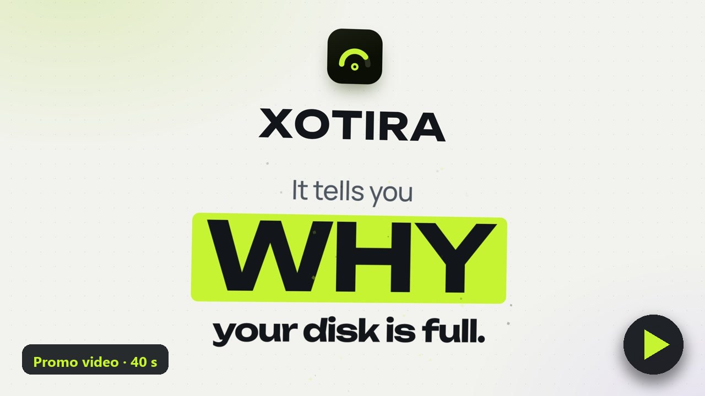
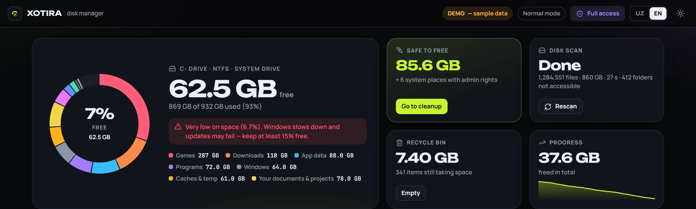
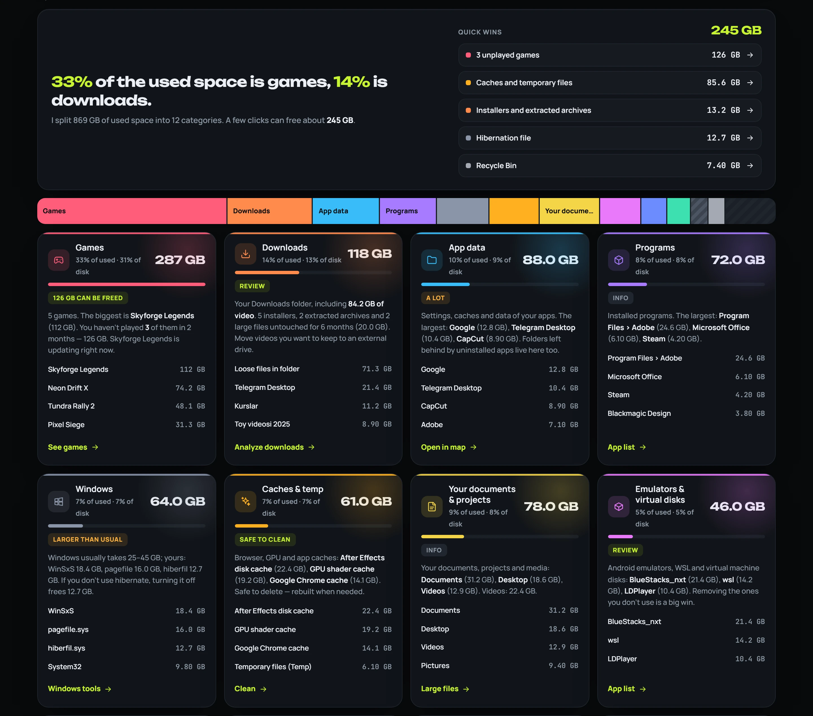
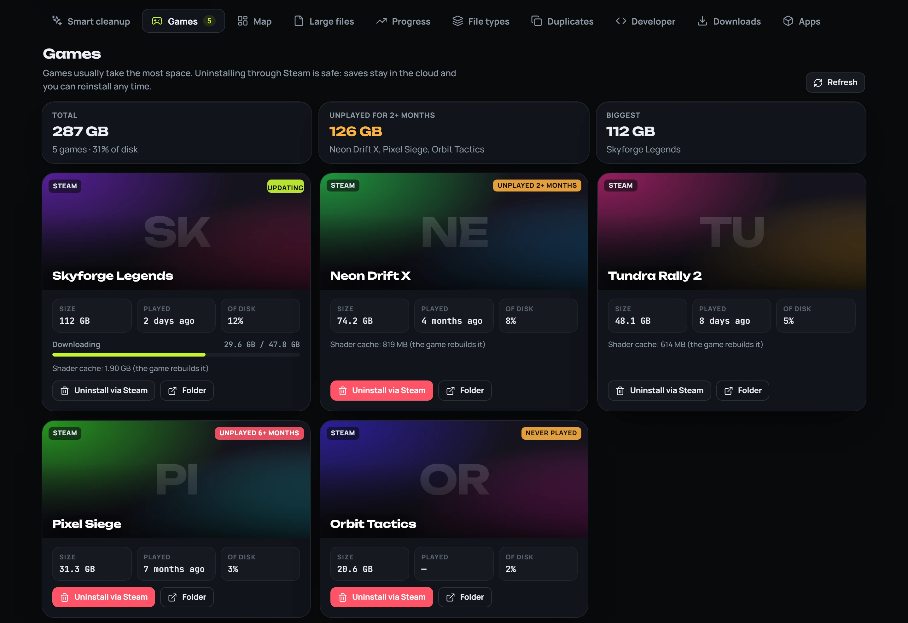
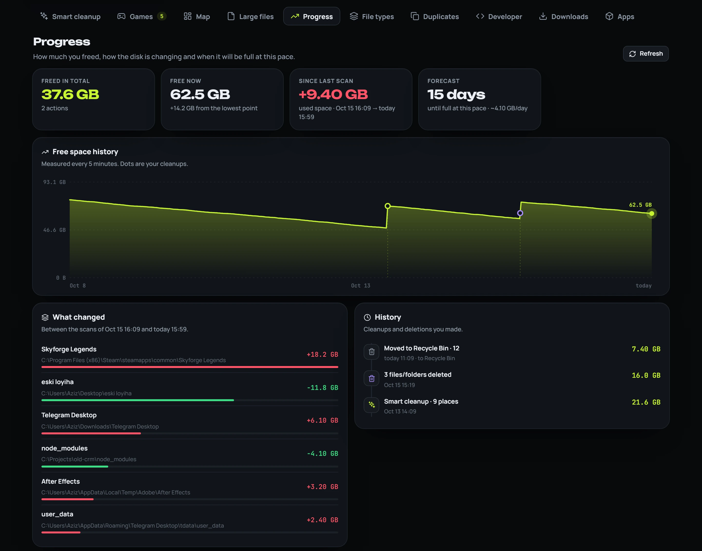
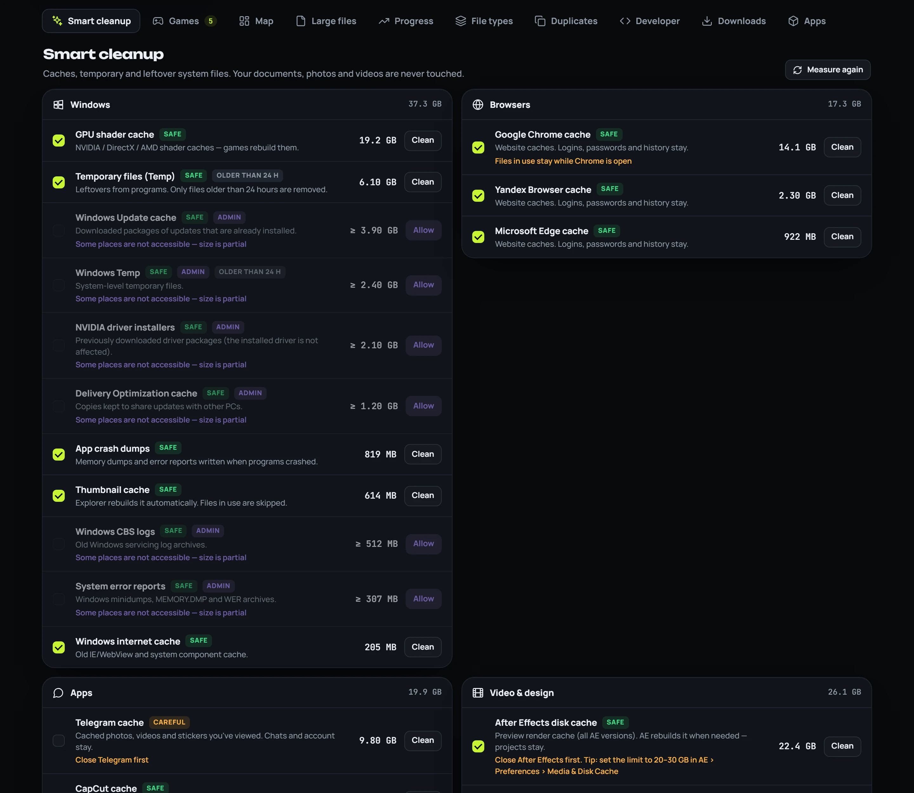
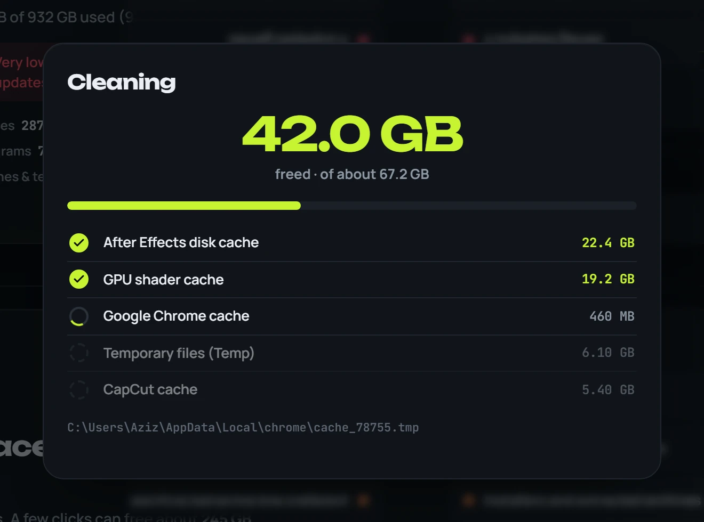
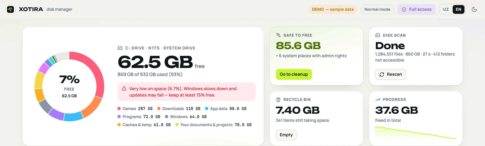
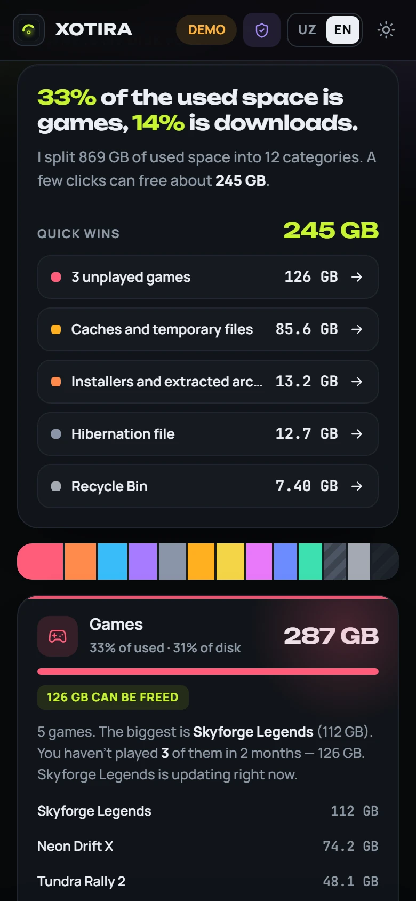

<p align="center">
  
</p>

<h1 align="center">Xotira</h1>

<p align="center">
  <b>Why is my disk full?</b><br>
  A smart, safe disk cleaner for Windows. It explains in plain words where your space went — and frees it in a few clicks.
</p>

<p align="center">
  <b>English</b> · <a href="README.uz.md">Oʻzbekcha</a>
</p>

<p align="center">
  <a href="https://github.com/humoyun200108/xotira/releases/latest"></a>
  
  
  
</p>

<p align="center">
  <a href="https://github.com/humoyun200108/xotira/releases/latest"><b>⬇ Download</b></a> &nbsp;·&nbsp;
  <a href="https://humoyun200108.github.io/xotira/"><b>▶ Live demo</b></a> &nbsp;·&nbsp;
  <a href="https://t.me/neyroai"><b>Telegram channel</b></a>
</p>

<p align="center">
  <a href="https://humoyun200108.github.io/xotira/promo/#en"></a><br>
  <sub>🎬 40-second promo · <a href="https://humoyun200108.github.io/xotira/promo/#en">watch</a> · <a href="https://github.com/humoyun200108/xotira/releases/download/v1.0.0/Xotira_promo_EN_2K_60fps.mp4">2K 60 fps</a> · <a href="https://humoyun200108.github.io/xotira/promo/#uz">Oʻzbekcha versiya</a></sub>
</p>



## Why Xotira

Your disk keeps filling up, but every folder looks important and you don't know what is safe to delete. Most tools either show a wall of folder sizes or "clean" blindly.

Xotira scans the whole drive in about 30 seconds and answers the real question: **what is taking the space, is that normal, and what can go?**

- “**33%** of the used space is games, **14%** is downloads.”
- “You haven't played **3 games** in 2 months — 126 GB.”
- “After Effects disk cache: 22 GB. Safe to delete — AE rebuilds it.”
- “Claude Desktop is installed twice — removing one frees 10 GB.”

## Features

| | |
|---|---|
| 🧭 **Why is my disk full?** | Used space split into 12 human categories — games, downloads, Windows, app data, caches, emulators & virtual disks, AI models, your documents… Each with a verdict (*normal / a lot / safe to clean*), the biggest items and a one-click next step. |
| ✨ **Smart cleanup** | About 40 known cache and temp locations: browsers, Telegram, CapCut, Adobe & After Effects, GPU shader caches, npm/pip, Windows Update and more — each marked *safe* or *careful*. |
| 🎮 **Games** | Steam & Epic games with size, last played date and update progress. Games you haven't touched in months are flagged. Uninstall through Steam (your saves stay in the cloud). |
| 🗺️ **Map** | A treemap of any folder — click to dive in. |
| 📈 **Progress** | Total space freed, free-space chart with your cleanups marked, what grew or shrank between scans, and a forecast of when the disk will be full. |
| 🔎 **And more** | Large files with filters (including “changed in the last 24 h”), duplicate finder, `node_modules`/`venv` leftovers, Downloads analysis, installed apps by real size. |
| 🌗 **Made with care** | Uzbek & English, dark & light theme, live progress for every scan and cleanup, works on any screen size. |

<table>
  <tr>
    <td width="50%"></td>
    <td width="50%"></td>
  </tr>
  <tr>
    <td></td>
    <td></td>
  </tr>
  <tr>
    <td></td>
    <td></td>
  </tr>
</table>

<p align="center"></p>

> Screenshots use the built-in demo data — no real files.

## Safety first

- **Recycle Bin by default.** Deleted files can be restored. Permanent delete is a separate, explicit choice.
- **Protected locations.** Windows, Program Files, system files (`pagefile.sys`, `hiberfil.sys`), drive roots and your main user folders themselves can't be deleted.
- **Caches only in Smart cleanup.** Your documents, photos and videos are never touched there. Files in use are skipped; temp files newer than 24 hours are kept.
- **Asks before everything.** Every cleanup and deletion shows exactly what will go and how much space it frees.
- **Admin only when you ask.** Xotira runs as a normal user; “Full access” is a button you press.
- **Local and private.** The server listens on `127.0.0.1` only, actions require a custom header so websites can't trigger them, fonts are bundled — **nothing is sent anywhere**.

## Install

1. Download **`Xotira-Setup-x.y.z.exe`** from [Releases](https://github.com/humoyun200108/xotira/releases/latest).
2. Run it. It installs for your user only — no administrator rights needed.
3. Open **Xotira** from the desktop or Start menu.

**Seeing “Windows protected your PC”?** New open-source apps start without reputation in Microsoft SmartScreen. Click **More info → Run anyway**. The warning disappears as more people download the release.

### Why you can trust the installer

- It contains the **official Python runtime from python.org, signed by the Python Software Foundation** — the build refuses to continue if that signature is missing.
- Everything else is Xotira's **readable source code**: no packers, no obfuscation, no custom bootloader.
- Releases are **built by GitHub Actions from this repository**, with SHA-256 checksums and a [build provenance attestation](https://docs.github.com/actions/security-for-github-actions/using-artifact-attestations):
  ```
  gh attestation verify Xotira-Setup-1.0.0.exe -R humoyun200108/xotira
  ```
- Code signing: see [CODE_SIGNING.md](CODE_SIGNING.md).

## Run from source

Requires Windows 10/11 and Python 3.12+ (standard library only — nothing to `pip install`).

```
git clone https://github.com/humoyun200108/xotira
cd xotira
pythonw app\launcher.pyw
```

For development, `python app\server.py --open` runs the server in a console. The demo works in any browser: `python -m http.server -d app 8790` → <http://127.0.0.1:8790/?demo=1>.

## How it works

| File | Role |
|---|---|
| `app/server.py` | Stdlib HTTP server on `127.0.0.1:4477`. Multi-threaded `os.scandir` scanner (about 1 M files in ~30 s), the “why is it full” breakdown, cleanup jobs with live progress, history. |
| `app/index.html` | The whole interface — one page, no frameworks. |
| `app/launcher.pyw` | Starts the hidden server and opens Xotira in its own app window (Edge/Chrome `--app`). The server quits by itself a few minutes after the window closes. |
| `installer/` | `build.ps1` + Inno Setup script for the per-user installer. |
| `tools/` | Demo data, screenshots, icon and font helpers. |

History and logs live in `%LOCALAPPDATA%\Xotira`. Uninstalling removes everything.

## Building the installer

```
powershell -ExecutionPolicy Bypass -File installer\build.ps1
```

Needs [Inno Setup 6](https://jrsoftware.org/isdl.php). Output: `dist\Xotira-Setup-<version>.exe` and `dist\SHA256SUMS.txt`. Pushing a `v*` tag runs the same build in GitHub Actions and publishes the release.

## Author

**Humoyun Safarov** — Telegram [@humoyunsafarov](https://t.me/humoyunsafarov) · channel [@neyroai](https://t.me/neyroai)

Ideas, bugs and translations are welcome — open an issue or write on Telegram.

## License

[MIT](LICENSE) © 2026 Humoyun Safarov.
Xotira only deletes what you confirm, but it is provided “as is”, without warranty — review the list before deleting.
