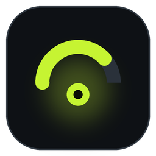
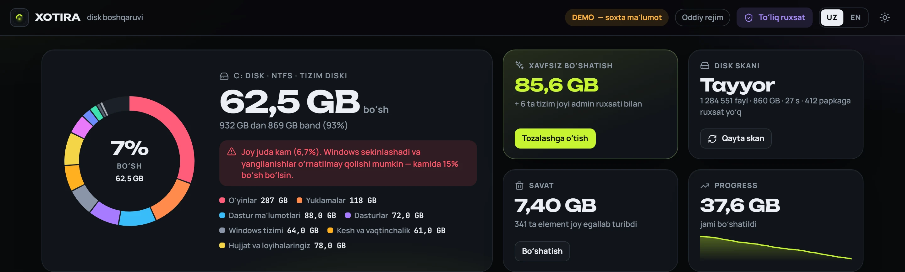
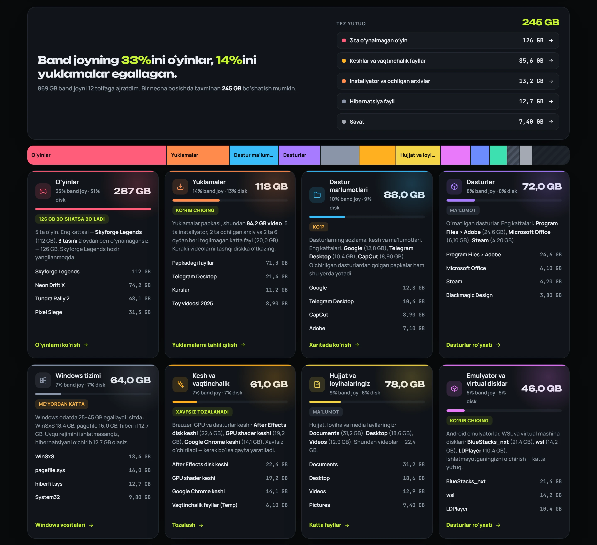
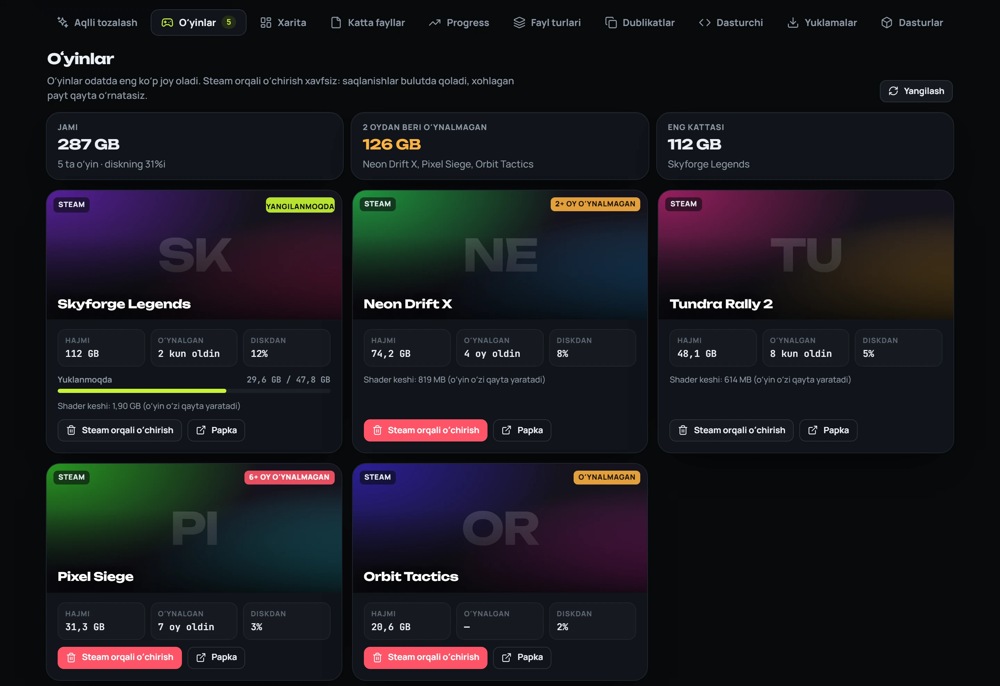
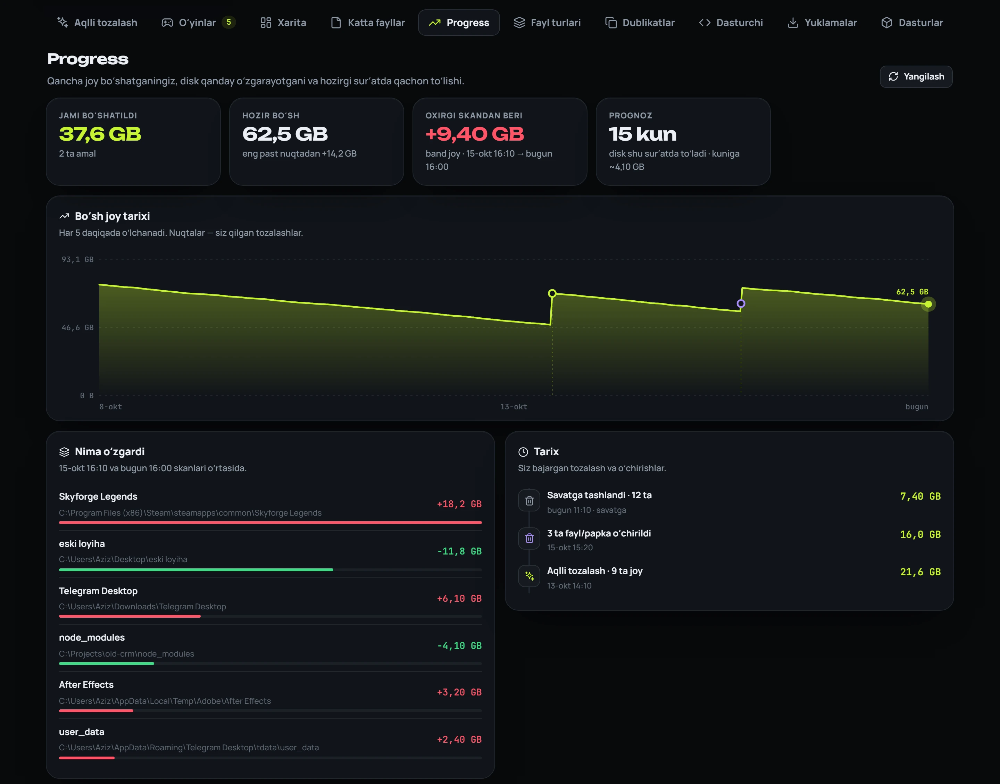
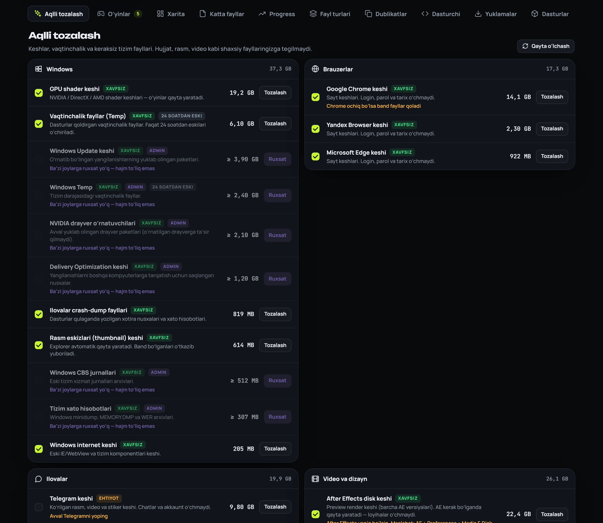
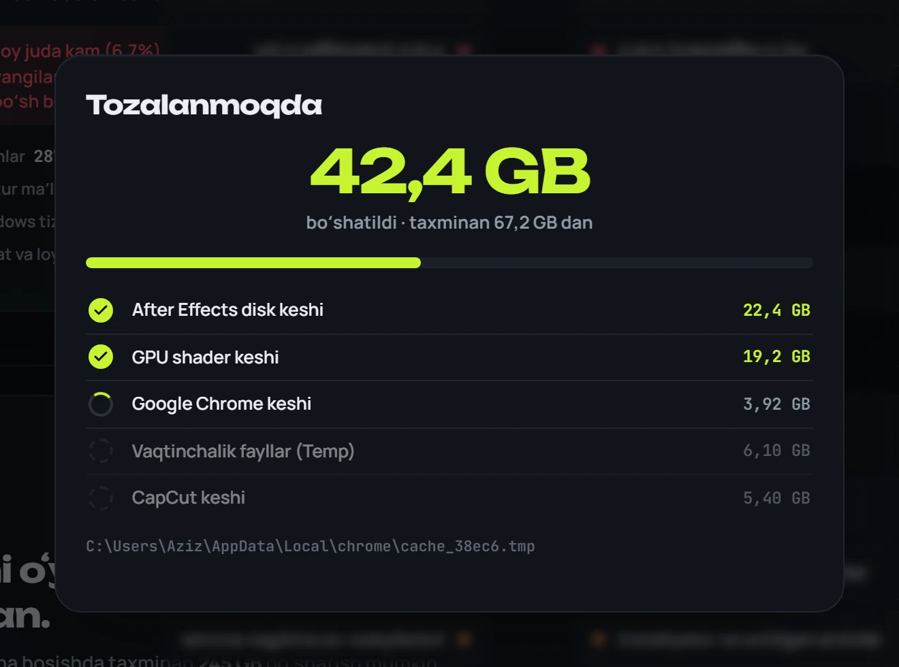
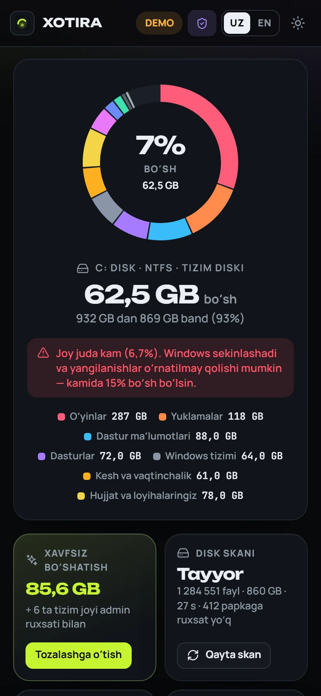

<p align="center">
  
</p>

<h1 align="center">Xotira</h1>

<p align="center">
  <b>Nega diskim toʻlib qoldi?</b><br>
  Windows uchun aqlli va xavfsiz disk tozalovchi. Joy qayerga ketganini oddiy tilda tushuntiradi va bir necha bosishda boʻshatadi.
</p>

<p align="center">
  <a href="README.md">English</a> · <b>Oʻzbekcha</b>
</p>

<p align="center">
  <a href="https://github.com/humoyun200108/xotira/releases/latest"></a>
  
  
  
</p>

<p align="center">
  <a href="https://github.com/humoyun200108/xotira/releases/latest"><b>⬇ Yuklab olish</b></a> &nbsp;·&nbsp;
  <a href="https://humoyun200108.github.io/xotira/?lang=uz"><b>▶ Jonli demo</b></a> &nbsp;·&nbsp;
  <a href="https://t.me/neyroai"><b>Telegram kanal</b></a>
</p>



## Nega Xotira

Disk toʻlib boryapti, lekin har bir papka muhimdek tuyuladi va nimani oʻchirish xavfsiz ekanini bilmaysiz. Koʻp dasturlar yo papkalar hajmini quruq roʻyxat qilib koʻrsatadi, yo koʻr-koʻrona “tozalaydi”.

Xotira butun diskni taxminan 30 soniyada skanerlaydi va asosiy savolga javob beradi: **joyni nima egallagan, bu normalmi va nimani oʻchirsa boʻladi?**

- “Band joyning **33%**ini oʻyinlar, **14%**ini yuklamalar egallagan.”
- “**3 ta oʻyin**ni 2 oydan beri oʻynamagansiz — 126 GB.”
- “After Effects disk keshi: 22 GB. Xavfsiz oʻchiriladi — AE uni qayta yaratadi.”
- “Claude Desktop ikki marta oʻrnatilgan — bittasini oʻchirsangiz 10 GB boʻshaydi.”

## Imkoniyatlar

| | |
|---|---|
| 🧭 **Nega joy band?** | Band joy 12 ta tushunarli toifaga ajratiladi: oʻyinlar, yuklamalar, Windows, dastur maʼlumotlari, keshlar, emulyator va virtual disklar, AI modellar, hujjatlaringiz… Har biri uchun baho (*meʼyorda / koʻp / xavfsiz tozalanadi*), eng katta elementlar va keyingi qadam tugmasi. |
| ✨ **Aqlli tozalash** | Qariyb 40 ta maʼlum kesh va vaqtinchalik fayl joylari: brauzerlar, Telegram, CapCut, Adobe va After Effects, GPU shader keshi, npm/pip, Windows Update va boshqalar. Har biri *xavfsiz* yoki *ehtiyot* deb belgilangan. |
| 🎮 **Oʻyinlar** | Steam va Epic oʻyinlari: hajmi, oxirgi oʻynalgan sanasi, yangilanish progressi. Oylab ochilmagan oʻyinlar belgilanadi. Steam orqali oʻchirish (saqlanishlar bulutda qoladi). |
| 🗺️ **Xarita** | Istalgan papkaning treemap koʻrinishi — bosib ichiga kirasiz. |
| 📈 **Progress** | Jami qancha boʻshatganingiz, tozalashlar belgilangan boʻsh joy grafigi, ikki skan oʻrtasida nima oʻsgani va kamaygani, disk qachon toʻlishi haqida prognoz. |
| 🔎 **Yana** | Filtrli katta fayllar (jumladan “soʻnggi 24 soatda oʻzgarganlar”), dublikat qidiruvchi, `node_modules`/`venv` qoldiqlari, Yuklamalar tahlili, oʻrnatilgan dasturlar haqiqiy hajmi bilan. |
| 🌗 **Did bilan** | Oʻzbek va ingliz tili, qorongʻi va yorugʻ mavzu, har bir skan va tozalash uchun jonli progress, istalgan ekran oʻlchamida ishlaydi. |

<table>
  <tr>
    <td width="50%"></td>
    <td width="50%"></td>
  </tr>
  <tr>
    <td></td>
    <td></td>
  </tr>
  <tr>
    <td></td>
    <td align="center"></td>
  </tr>
</table>

> Skrinshotlarda ichki demo maʼlumotlar ishlatilgan — haqiqiy fayllar emas.

## Xavfsizlik birinchi oʻrinda

- **Standart holatda — Savatga.** Oʻchirilgan fayllarni qaytarish mumkin. Butunlay oʻchirish alohida, aniq tanlov.
- **Himoyalangan joylar.** Windows, Program Files, tizim fayllari (`pagefile.sys`, `hiberfil.sys`), disk ildizi va asosiy foydalanuvchi papkalarining oʻzini oʻchirib boʻlmaydi.
- **Aqlli tozalash faqat keshlarga tegadi.** Hujjat, rasm va videolaringizga tegilmaydi. Band fayllar oʻtkazib yuboriladi, 24 soatdan yangi vaqtinchalik fayllar qoldiriladi.
- **Hammasidan oldin soʻraydi.** Har bir tozalash va oʻchirishda aniq nima ketishi va qancha joy boʻshashi koʻrsatiladi.
- **Admin faqat siz xohlasangiz.** Xotira oddiy foydalanuvchi sifatida ishlaydi; “Toʻliq ruxsat” — siz bosadigan tugma.
- **Mahalliy va maxfiy.** Server faqat `127.0.0.1` da ishlaydi, saytlar uning amallarini chaqira olmaydi, shriftlar dastur ichida — **hech narsa internetga yuborilmaydi**.

## Oʻrnatish

1. [Releases](https://github.com/humoyun200108/xotira/releases/latest) sahifasidan **`Xotira-Setup-x.y.z.exe`** ni yuklab oling.
2. Ishga tushiring. Faqat sizning foydalanuvchingiz uchun oʻrnatiladi — administrator ruxsati kerak emas.
3. Ish stoli yoki Start menyusidan **Xotira**ni oching.

**“Windows protected your PC” chiqdimi?** Yangi ochiq kodli dasturlarning Microsoft SmartScreen'da hali obroʻsi boʻlmaydi. **More info → Run anyway** ni bosing. Yuklab olishlar koʻpaygani sari bu ogohlantirish yoʻqoladi.

### Nega oʻrnatuvchiga ishonsa boʻladi

- Ichida **python.org'ning rasmiy Python'i bor, u Python Software Foundation tomonidan imzolangan**. Imzo boʻlmasa, yigʻish jarayoni toʻxtaydi.
- Qolgan hammasi Xotira'ning **ochiq, oʻqiladigan kodi**: hech qanday packer, shifrlash yoki maxsus bootloader yoʻq.
- Relizlar **shu repozitoriydan GitHub Actions orqali yigʻiladi**, SHA-256 checksum va [build provenance attestatsiyasi](https://docs.github.com/actions/security-for-github-actions/using-artifact-attestations) bilan:
  ```
  gh attestation verify Xotira-Setup-1.0.0.exe -R humoyun200108/xotira
  ```
- Kod imzosi: [CODE_SIGNING.md](CODE_SIGNING.md).

## Koddan ishga tushirish

Windows 10/11 va Python 3.12+ kerak (faqat standart kutubxona — `pip install` shart emas).

```
git clone https://github.com/humoyun200108/xotira
cd xotira
pythonw app\launcher.pyw
```

Dasturlash uchun: `python app\server.py --open`. Demo istalgan brauzerda ishlaydi: `python -m http.server -d app 8790` → <http://127.0.0.1:8790/?demo=1&lang=uz>.

## Qanday ishlaydi

| Fayl | Vazifasi |
|---|---|
| `app/server.py` | `127.0.0.1:4477` dagi standart kutubxonali HTTP server. Koʻp oqimli skaner (taxminan 1 mln fayl ~30 soniyada), “nega toʻlgan” tahlili, jonli progressli tozalash, tarix. |
| `app/index.html` | Butun interfeys — bitta sahifa, frameworksiz. |
| `app/launcher.pyw` | Serverni yashirin ishga tushiradi va Xotira'ni alohida oynada ochadi (Edge/Chrome `--app`). Oyna yopilgach server bir necha daqiqada oʻzi toʻxtaydi. |
| `installer/` | `build.ps1` va foydalanuvchi uchun oʻrnatuvchining Inno Setup skripti. |
| `tools/` | Demo maʼlumot, skrinshot, ikonka va shrift yordamchilari. |

Tarix va loglar `%LOCALAPPDATA%\Xotira` da saqlanadi. Dasturni oʻchirsangiz, hammasi oʻchadi.

## Muallif

**Humoyun Safarov** — Telegram [@humoyunsafarov](https://t.me/humoyunsafarov) · kanal [@neyroai](https://t.me/neyroai)

Gʻoya, xato yoki tarjima boʻyicha issue oching yoki Telegram'da yozing.

## Litsenziya

[MIT](LICENSE) © 2026 Humoyun Safarov.
Xotira faqat siz tasdiqlagan narsani oʻchiradi, lekin “boricha” (kafolatsiz) taqdim etiladi — oʻchirishdan oldin roʻyxatni koʻrib chiqing.
